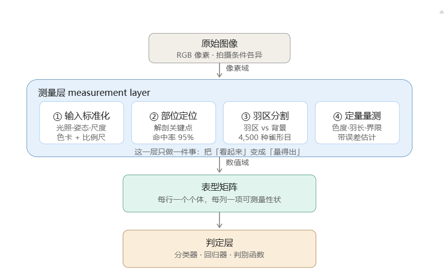

# 鸟类研究随记

> 学习中

1、目前鸟类在计算机方向多为物种识别，而较少在年龄判定
  所以年龄判定在该领域有什么意义？

2、排除路径
（1）形态测量可作为性别判定工具而不能作为年龄判别工具
（2）鸟类中存在羽饰延迟的现象，不能简单的凭借羽色去判定年龄
（3）若训练图像集中在短时期内，模型会依赖「换羽/羽饰状态」这类临时特征，导致跨时间泛化失败——这对「用羽色做年龄分类」是正面警告。

3.可试做方向
（1）先做一个 200–500 张的小规模「翼面关键点 + 大覆羽界限」标注集，验证界限位置能否被稳定预测（用序数回归评估，别用普通分类），再考虑接入 WRP 编码。
（2）中文语境==red:野生鸟==判龄
中文文献清一色物种识别：TC-YOLO、《应用生态学报》2025 改进 YOLOv8n（mAP 0.704→0.722）、《科学技术与工程》2025 机场鸟击识别——没有一篇把年龄当输出维度。限定词是「野生鸟类」，家禽日龄识别已有但不可迁移。

# 参考文献

（1）Yorzinski & Clark (2026)：「全黑」乌鸦羽色中的年龄信号
- 出处：Yorzinski J.L., Clark A.B. "Inter- and intra-individual variation in the feather coloration of American crows." Journal of Avian Biology 2026: e03604. DOI: 10.1002/jav.03604
- 要解决的问题：看似羽色单一（全黑）的性单态物种，是否仍携带年龄信息？
- 技术架构：博物馆标本 + 鸟类视觉模型（avian visual model，考虑鸟类四色视觉与紫外感知）定量测量羽色 → 判别函数分析（DFA）进行年龄级分类。
- 核心发现：== 羽色随年龄级变化而与性别无关——年长个体色调不同、紫外反射更高；DFA 能以高成功率将个体归入年龄级。==
- 方法学亮点：发现羽色不随「距上次换羽时间」变化，但随标本采集年代变化——首次定量揭示标本老化对色彩测量的干扰，对所有基于标本的羽色研究都是重要警示。
- 启示：对 AI 而言，「看起来一样」不等于「像素/光谱上真的一样」；==单态物种的细粒度年龄信号可能藏在紫外通道中。==
（2）Juhant (2026)：基于照片的五级年龄划分（栗翅鹰）
- 出处：Juhant M.A. "Framing the natural history of the bay-winged hawk (Parabuteo unicinctus unicinctus) for accurate taxonomic assessment." Ornithology Research 34: 14. DOI: 10.1007/s43388-026-00282-3
- 技术方案：139 只拍照个体 + 野外行为观察，用照片（而非标本或捕获个体）完成年龄分级。
- 核心发现：南美型栗翅鹰需 4 个年度换羽周期才达成成羽：==Basic I（≤8 月龄）、Basic II（9–20 月）、Basic III（21–32 月）、Basic IV（32–44 月）、Basic V（≥45 月）。==
- 价值：传统鉴定与公民科学影像数据结合的代表；为长寿命猛禽的「照片判龄」提供了可复制范式。
 - 难题：==照片质量、拍摄角度对判读的限制==；罕见中间羽衣的样本不足。
（3）Pyle (2022)：用公民科学照片库研究蜂鸟换羽与年龄
- 出处：Pyle P. "Examination of digital images from Macaulay Library to determine avian molt strategies…" Wilson Journal of Ornithology 134: 52–65. DOI: 10.1676/21-00012
- 方法学开创性：首次系统论证公民科学照片库（Macaulay Library）可作为换羽/年龄研究的一手数据源，并给出严格的拍摄协议（≥2000×1500 像素、禁闪光、上翼面完整可见）。
- 延伸成果：中美洲 19 种蜂鸟可依据换羽模式与喙部波纹（bill corrugation）判龄判性（Journal of Field Ornithology 94(3): art.11）——==blue:喙部波纹==是蜂鸟独有的年龄指标，随年龄增长而消退。
- 意义：架起了「公民科学大数据」与「精细年龄判定」之间的桥梁，也是未来 AI 年龄模型最现实的数据来源通道。
（4）Depot et al. (2026)：鱼鹰雏鸟的照片判龄指南
- 出处：Depot K.M., Poole A.F., Purtell G. "A Photographic Guide to Plumage-Based Estimation of Nestling Age in Osprey." Journal of Raptor Research 60(2): 1–9. DOI: 10.3356/jrr2590
- 要解决的问题：巢期监测中很难目击孵化时刻，需要非接触式雏鸟日龄估计。
- 技术架构：2019–2022 四个繁殖季对 0–47 日龄已知年龄雏鸟系统拍照 → 建立 11 个羽饰发育阶段参考体系 → 盲测 548 只 → 序数 logistic 回归建立「羽饰阶段 → 日龄」映射 → 附 320 张已知年龄照片的交互式图库。
- 精度验证：5 名无经验观察者对 100 张随机照片判读，79% 与作者阶段一致、21% 落在相邻阶段（无跨两级错误）。
- 意义：少见的对「照片法替代捕捉测量」的严格精度验证研究；==序数回归建模思路可直接迁移到 AI 年龄分级任务（年龄天然是有序类别，不宜当普通多分类处理）。==
（4）Big Bird 数据集 (2026)：全球无人机鸟类影像的物种-年龄-性别联合标注
- 出处："Big Bird: A global dataset of birds in drone imagery annotated to species level." Remote Sensing in Ecology and Conservation. DOI: 10.1002/rse2.70059
- 数据规模：迄今标注最精细的无人机鸟类数据集——7 大洲、101 个物种、49,990 只个体；每只鸟标注位置、物种、姿态（飞行/静止/其他）、年龄（chick / juvenile / adult）与性别。
- 年龄标注规范（明确写为「依据羽饰」）：仍存绒羽者记为雏鸟；已褪绒羽但未获成鸟羽饰者记为亚成体；无法确定标 unknown。
- 技术架构与结果：基于 Faster R-CNN，检测 mAP 0.91±0.25；物种-年龄-性别联合分类 mAP 0.65±0.33；处理速度较人工快 85 倍。
- 性能驱动因素分析：训练-测试图像相似度（Estimate=1.3248, P=0.00021）、类间相似度、每类训练实例数、鸟体像素面积。
- 关键解读==red:：联合分类 mAP 0.65 明显低于纯检测的 0.91，说明「年龄」是联合任务中最难的一环；性能受「地理相似性」强驱动，意味着模型学到的是地域相关羽饰型，泛化到新地区会掉。==
（5）He et al. (2022)：深度学习分割羽色——测量层标杆
- 出处：He Y., Varley Z.K., Nouri L.O. 等. "Deep learning image segmentation reveals patterns of UV reflectance evolution in passerine birds." Nature Communications 13: 5068. DOI: 10.1038/s41467-022-32586-5
- 技术架构：DeepLab 系语义分割模型（显著优于阈值法、区域生长、Graph Cut、Chan-Vese 等传统方法），从 >24,000 件博物馆标本照片、>4,500 种雀形目中提取全身羽色（含紫外）反射信息。代码开源：github.com/EchanHe/DL_seg_avian_plumage
- 解决的问题：==把羽色从像素变成可比较的定量表型——这是任何「用图像判定年龄」的工作都必须先解决的测量层问题。==
- ==pink:难题==：博物馆标本姿态、光照不均一；紫外通道的标定。
（6） He et al. (2023)：姿态估计自动定位解剖部位
- 出处：He Y., Cooney C.R., Maddock S., Thomas G.H. "Using pose estimation to identify regions and points on natural history specimens." PLOS Computational Biology 19(2): e1010933. DOI: 10.1371/journal.pcbi.1010933
- 技术架构：姿态估计（关键点定位）在标本图像上自动定位解剖部位；鸟类数据集中 95% 图像被正确标注，由预测点导出的颜色测量与人工测量高度相关。
- 意义：羽色判龄的关键正是「分部位」（头、背、翼覆羽、尾），==red:部位定位此前一直靠人工框选——该工作补齐了自动化流水线的关键一环。==
- 延伸：同团队 Cooney et al. (2022, Nature Ecology & Evolution 6: 622–629) 用该流水线量化 >4,500 种雀形目「色彩丰富度」的纬度梯度，证明方法可扩展性。

# 结论
1. 方法论共识已形成：==年龄判定的黄金标准是换羽界限与羽代对比，羽色/虹膜为辅助==，形态测量主要服务于性别。Pyle (2022) 指南 + WRP 系统（Pyle et al. 2022）构成 2021 年以来最稳固的基石。
2. AI 侧的真正突破在「==green:测量层==」而非分类器：He et al. (2022, 2023) 证明深度学习能稳定分割羽区与定位解剖关键点；而直接年龄分类（Banerjee 2024、AI for Eagles）仍停留在小样本概念验证，Big Bird 的联合 mAP 0.65 是目前最接近实用规模的结果。

3. 共同瓶颈是标签，不是算法：传统路线缺热带/南半球物种的换羽序列数据；AI 路线缺带已知年龄的标注图像（AI for Eagles 仅 500 张）。Pyle (2022) 用 Macaulay Library 照片做换羽研究 + 环志数据库（MAPS/MoSI），恰好是两路线最现实的结合点。
4. 年龄是天然的有序变量：Osprey 研究用序数 logistic 回归、AI for Eagles 显示标签偏向成鸟会毁掉模型——年龄建模应按序数回归/ ordinal classification 设计，而非普通多分类。
5. 两端不对称性：Genovart et al. (2022) 证明「年轻可辨、衰老难辨」可能是外观特征判龄的普适上限，研究设计时应据此设定合理预期。

